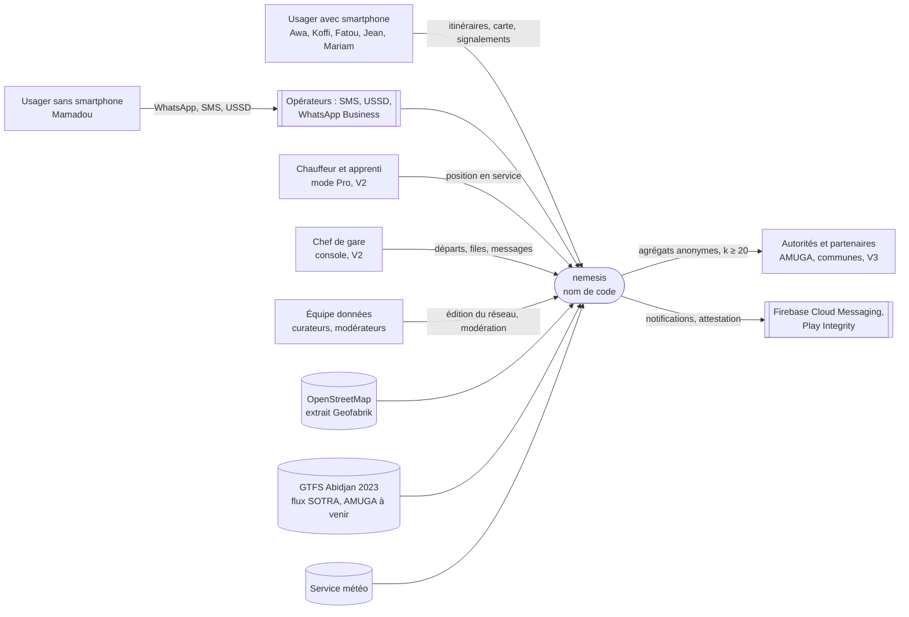
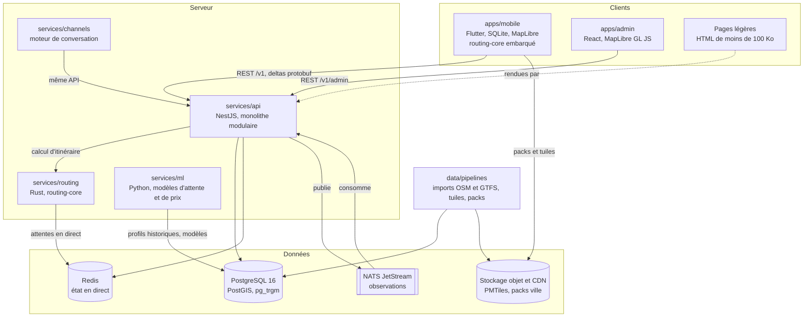
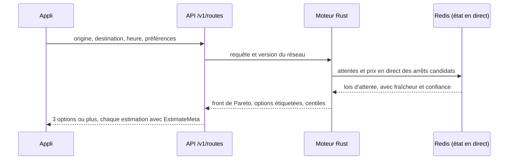
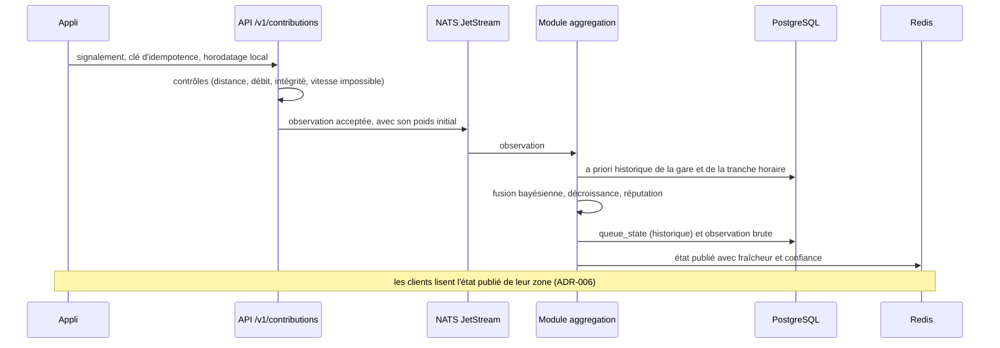

# Architecture

Version 0 du 2026-11-04 (incrément I0.3). Les choix marqués « ADR » sont détaillés dans [docs/DECISIONS](DECISIONS/README.md) ; ceux qui ne sont pas encore figés y sont au statut « proposé ».

## Principes qui guident l'architecture

| Principe du cahier des charges | Conséquence technique |
|--------------------------------|------------------------|
| Hors ligne par défaut (3.4.2) | Le calcul d'itinéraire tourne aussi sur le téléphone, à partir d'un pack ville. Le temps réel enrichit le résultat sans le conditionner. |
| Mêmes résultats en ligne et hors ligne | Un seul moteur d'itinéraires en Rust (`routing-core`), utilisé par le serveur et par l'appli (ADR-003). |
| Sobriété data (3.4.3) | Réponses compactes, packs différentiels, temps réel limité à la zone affichée (ADR-006). |
| Honnêteté (règle 1.3.2) | Toute estimation voyage avec sa fraîcheur, sa confiance et sa source (`EstimateMeta`), du modèle de données jusqu'à l'écran. Le contrat d'API rejette une estimation qui ne les porte pas. |
| Multimodal et multi-villes (3.4.8) | `city_id` dans chaque table, projection métrique choisie par ville, modes en référentiel. |
| Monolithe modulaire (9.1) | Une API principale découpée en modules aux frontières nettes. On n'en extrait un service que si la charge le prouve. |
| Interrupteurs de fonctionnalité (15.5) | Chaque fonctionnalité, et chaque module optionnel (paiement, publicité, portail partenaires), se désactive par configuration. |
| Vie privée dès la conception (1.3.4) | Identité et mobilité sont séparées dans la base. Les traces sont tronquées sur le téléphone. Les exports sont agrégés avec k ≥ 20. Voir [PRIVACY.md](PRIVACY.md). |

## Vue de contexte (C4, niveau 1)

## Vue des conteneurs (C4, niveau 2)

### Rôle de chaque conteneur

| Conteneur | Responsabilités | Ne fait pas |
|-----------|-----------------|-------------|
| `apps/mobile` | Recherche, résultats, pas à pas, suivi de trajet, contributions avec file d'envoi hors ligne, détection de montée et de descente sur le téléphone, calcul hors ligne, mode Pro (V2) | Envoyer des traces brutes non tronquées |
| `apps/admin` | Éditeur de réseau versionné, modération, incidents, tableaux de bord qualité, gestion des sources | Accéder aux identités : rôles distincts, journal d'audit |
| Pages légères (`apps/web-lite`) | Itinéraire partagé et trajet suivi en direct, lisibles sans appli | Exécuter du JavaScript lourd |
| `services/api` | Modules : `places`, `routes`, `stations`, `live`, `contributions`, `aggregation`, `incidents`, `packs`, `accounts`, `admin`, `partners` (V3), `payments` et `ads` (désactivés) | Calculer les itinéraires lui-même |
| `services/routing` | Service HTTP autour de `routing-core` : McRAPTOR multicritère, Monte-Carlo, choix des options étiquetées | Stocker des données d'usager |
| `services/ml` | Entraînement quotidien, profils historiques d'attente et de prix, régression par quantiles (V2), calibration | Servir les usagers en direct : il publie des paramètres lus par l'API et le moteur |
| `services/channels` | Moteur de conversation commun (11.1), adaptateurs WhatsApp, SMS (GSM 7 bits), USSD, serveur vocal | Avoir sa propre logique d'itinéraire : il appelle la même API |
| `data/pipelines` | Imports OSM et GTFS, validation, rapports d'écarts, tuiles PMTiles, packs ville versionnés et différentiels | Tourner sur le chemin d'une requête usager |

## Flux principaux

### 1. Calcul d'itinéraire en ligne

Budget : 2 s au 95e centile côté serveur et 30 Ko au plus par recherche (partie 9.3).

### 2. Calcul d'itinéraire hors ligne et parité

L'appli embarque `routing-core`, compilé pour Android (ADR-003). Elle calcule sur le pack ville : réseau, profils d'attente et de prix historiques. Pour qu'une même requête donne le même résultat des deux côtés :
- le code est le même ;
- la version des données est la même, puisque le pack porte la version du réseau ;
- le tirage de Monte-Carlo est déterministe : sa graine est dérivée de la requête et de la version des données.

Des tests de contrat rejouent une même liste de requêtes côté serveur et dans l'appli, et comparent les résultats. Une différence n'est attendue que lorsque le serveur dispose de données en direct.

### 3. D'une observation à l'état publié

Les contributions faites hors ligne attendent dans une file sur le téléphone et partent au retour du réseau. Grâce à la clé d'idempotence, un renvoi n'est jamais compté deux fois. Les formules sont dans [ALGORITHMES.md](ALGORITHMES.md).

### 4. Canaux sans smartphone

WhatsApp, SMS, USSD et serveur vocal passent tous par `services/channels`. Le moteur de conversation reconnaît l'origine et la destination, propose des choix numérotés quand c'est ambigu, puis appelle `/v1/routes`. Il met enfin la réponse en forme selon le canal : deux SMS au plus en GSM 7 bits, des écrans USSD d'environ 180 caractères. Les estimations, et leur fraîcheur, sont les mêmes que dans l'appli. Des tests croisés vérifient qu'une même requête donne la même recommandation sur tous les canaux (11.7).

### 5. Packs hors ligne

Chaque nuit, `data/pipelines` produit pour chaque ville un pack versionné, puis le différentiel avec la version précédente. Le pack contient le réseau, les repères avec leurs alias, les profils historiques d'attente et de prix, et un fond de carte léger en option. Le tout est déposé sur le stockage objet derrière un CDN. L'appli télécharge le pack complet en Wi-Fi, puis seulement les différentiels.

Budgets (F-12) :
- pack sans fond de carte : moins de 15 Mo ;
- pack avec fond de carte léger : moins de 60 Mo ;
- différentiel quotidien : moins de 300 Ko.

### 6. Modification du réseau

Un curateur propose une modification dans le back-office (`change_request`). Un second rôle la revoit, puis elle est publiée sous une nouvelle `network_version`, avec une date d'effet. La publication déclenche trois choses : le rechargement du moteur, un pack différentiel et un message aux usagers concernés. Objectif : un itinéraire corrigé dans l'heure (parcours 10 de la partie 4.2). Une version qui contient des enregistrements fictifs ne peut pas être publiée.

## Sujets transverses

- **Sécurité.** Référentiels OWASP MASVS et ASVS ; TLS partout et épinglage de certificat dans l'appli. Le back-office exige une authentification à deux facteurs et des rôles, et tient un journal d'audit chaîné. Les secrets sont hors du code.
- **Vie privée.** La base a deux schémas, `identity` et `mobility`, avec des rôles distincts. Les pseudonymes des appareils sont renouvelés. Les traces sont tronquées de 300 m au départ et à l'arrivée. Voir [PRIVACY.md](PRIVACY.md).
- **Observabilité.** OpenTelemetry dans chaque service ; Prometheus, Grafana et Loki en phase 1. Les tableaux de bord produit, sans donnée personnelle, sont séparés des tableaux de bord techniques.
- **Traductions.** Toutes les chaînes sont des clés, avec les règles de pluriel ICU. Le français de Côte d'Ivoire est fourni au MVP, le dioula en V2.
- **Multi-villes.** Chaque ville a son fuseau horaire (Africa/Abidjan pour Abidjan), sa devise (XOF), sa projection métrique (EPSG:32630 pour Abidjan) et son pack.

## Budgets de performance et choix associés

| Budget (partie 9.3) | Choix qui le sert |
|---------------------|-------------------|
| APK de 20 Mo au plus, objectif 15 Mo | Découpage par processeur, R8, mesure dès le prototype (ADR-001) |
| Démarrage à froid en 2,5 s au plus | Rien de lourd au démarrage ; base SQLite déjà indexée dans le pack |
| Itinéraire en 2 s au p95 côté serveur, 3 s hors ligne | Moteur Rust à fréquences, réseau précompilé (ADR-003) |
| 150 Ko au plus par minute de carte active | Temps réel limité aux tuiles visibles, deltas en protobuf (ADR-006) |
| 4 % de batterie par heure de suivi | Échantillonnage adaptatif, géorepérage pour l'alerte de descente (partie 8.5) |
| API disponible 99,5 % du temps | Monolithe simple à exploiter ; base répliquée ; repli hors ligne dans l'appli |

## Points ouverts

| Sujet | Où il sera tranché |
|-------|--------------------|
| Flutter ou Kotlin | ADR-001, après mesure sur le prototype (I0.11) |
| Moteur A ou B | ADR-003, après le spike (I0.8) |
| Hébergement et transfert des données | ADR-004 : décision du porteur du projet |
| Mode Pro dans la même appli ou dans une appli séparée | ADR à rédiger avant la V2 (partie 6.1) |
| Schéma des tuiles (OpenMapTiles ou Shortbread) et attribution | I0.7, voir [DATA.md](DATA.md) |
